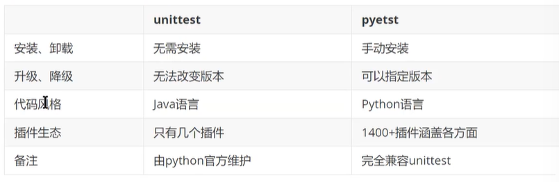
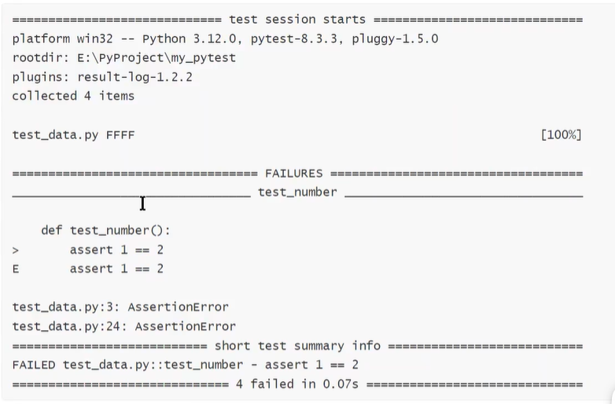
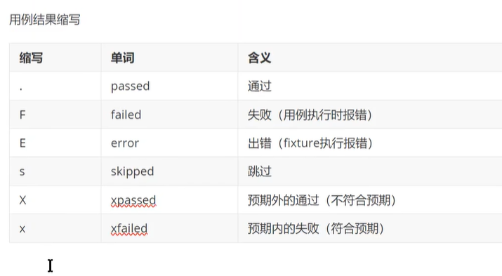
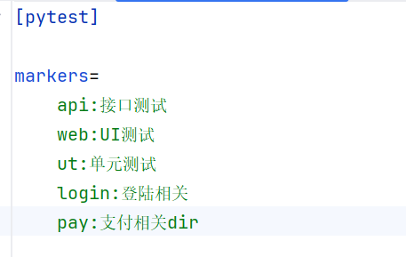
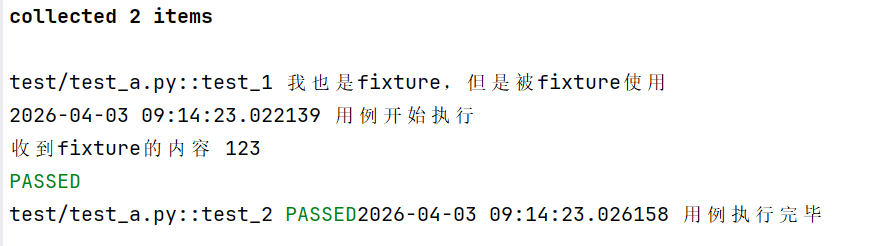

from aiohttp.helpers import validate_etag_value

# 1.测试框架  
1. 测试框架：**抽象**出来的**工具集合**，提供了大量组件、工具、功能
    ````
   * 用例发现：自动从各个地方找测试用例
   * 用例管理：选择哪部分用例执行 哪部分不执行
   * 环境管理：启动环境 测完后自动关掉 前置条件和后置清理现场  
   * 用例执行：执行用例并收集结果  
   * 测试报告：用例发现、环境管理、执行过程、执行结果 整合为报  
    ````
2. 大部分语言 都有测试框架 软件测试是软件设计的必不可少的过程  
* java：junit，testng
  * python：unittest pytest   
  
#  2.快速上手  
1. 安装
     ```
    pip install pytest
    # 升级：pip install pytest -U
      ```
2.  **3种启动方式**
      1. 命令 直接终端输入pytest
      2. 代码 创建一个新文件
      3. 创建好函数后绿色执行按钮 直接点 不推荐（pycharm提供的功能）且容易找不到文件 这个最适合绝对路径 其他都不合适 对代码有影响  
    ```
    import pytest
    pytest.main()
    ```
3. pytest在简单的基础上，对断言进行高级封装（AST），对python数据结构断言，非常友好  
    1. 断言是什么：
        ```python
       def test_basic_assert():
         result = 1 + 2
         # 核心断言：如果 result 等于 3，测试通过；否则报错
         assert result == 3
       ``` 
    实际结果（代码运行出来的值）和 预期结果（你认为应该的值）。断言就是用来做这个对比的动作。
    如果对比一致（符合预期）
     → 测试通过 (PASS)
     →如果对比不一致（不符合预期） → 测试失败 (FAIL)  
#  3. 看懂结果
  
    1. 执行环境：platform 输出的是执行环境  
    2. rootdir；根目录  
    3. collected items 用例的收集情况  
    4. plugins 插件  
    5. 执行过程 首先有一个文件名称 test_data.py  执行结果  
    6. 失败详情 用例内容 断言提示   
    7. 整体摘要 summary 结果情况 数量 花费时间    
  
# 4.用例规则  
**1. 用例的发现规则：**  
pytest怎么找到的用例
1. pytest会遍历所有的目录 除了.开头的隐藏目录 venv  
2. 默认会打开python文件 test_开头 或者 test_结尾 就是用例文件
3. 遍历所有的Test**开头**类 class Test 不会遍历
4. 收集所有test_开头的**函数 或者 方法**  **_方法和函数的根本区别是他们的参数_**
**2. 用例的内容规则：**
pytest8.4 增加了强制要求
**pytest对用例的要求：**
    1. 可调用的（函数 方法 类）
    2. 名字test_开头  
    3. 没有参数（参数有另外的要求）
    4. 没有返回值（8.4） 
**3. 练习**  
   有函数 add 接受两个参数 并返回他们相加的结果 请为此编写测试用例  
```python
def add(a,b):
    return a+b
# 测试：一个是整数型 一个是字符串型
def test_add():
    res=add(1,3)
    assert res==4
def test_add_():
    res=add("1","3")
    assert res=="13"
   ```
但现在一个用例一个函数 第一个是add 第二个add_ 第三个不能是add__ 不好  
所以这个时候 就使用类   都先用函数搞定 太多了才用类  
方法不能额外加参数
```python
def add(a,b):
    return a+b
class TestAdd:
    def test_int(self):
        res=add(1,3)
        assert res==4
    def test_str(self):
        res=add('1','3')
        assert res=='13'
    def test_list(self):
        res=add([1],[3,4])
        assert res=="13"
```
# 5. 配置框架  
配置可以改变pytest的默认规则  
1. 命令参数  
2. ini配置文件  
所有的配置方式可以一键获取  
   **pytest-h** 
   1. 可以看见所有配置
   2. 分别是什么方式  
        * `-`开头 就是参数  
        * 大写字母开头：环境变量  
        * 小写字母开头：ini配置 
   3. 配置文件 pytest.ini
```
pytest -vv
# 加了这个以后会显示用例的进度
-v 增加详细程度
-s 在用例中正常的使用输入和输出
因为默认情况下输入输出是会被拦截掉的
-x 快速退出 一旦发现用例错误 直接终止
-m 用力筛选
```
# 6. 标记mark
1. 标记可以让用例与众不同 进而让用例被区别对待
    ## 1. 用户自定义标记  
        用户自定义标记，只能实现用例筛选  
    步骤：先注册 再标记 第一部注册：
    
        注意 开始忘记了tab 四个空格 导致标记不成功
    使用： pytest -m api 实现筛选
    ` ================================ 
(flask-env) PS D:\my-software\pycharm_projects\campus_trade> pytest -m api
================================= test session starts =================================
platform win32 -- Python 3.10.19, pytest-9.0.2, pluggy-1.6.0
rootdir: D:\my-software\pycharm_projects\campus_trade
configfile: pytest.ini
plugins: anyio-4.12.1
`
    第二步标记：
    ## 2. 框架内置标记  
        用户自定义标记 为用例增加特殊执行效果  
    1. 和用户自定义标记的区别：
        1. 无需注册（pytest --markers 已经有了），可以直接使用
       2. 不仅可以筛选，还可以增加特殊的效果
       3. 不同的标记，增加不同的特殊效果
          * **skip 无条件跳过不执行**
          * **skipfi：有条件跳过**
          * **xfail：预期失败**
          * **parametrize：参数化**
          * **usefixture：使用fixture**
          * xpassed 预期外的通过，xfail 预期内的失败
       数据驱动测试=参数化测试+数据文件  
       根据数据文件的内容，动态决定用例的数量和内容
# 7. 数据驱动测试参数  
1. 先补充一点csv文件读取数据的内容
```python
import csv
f=open('data.csv')
# DictReader 会将 CSV 文件的第一行（表头）作为字典的键 (Key)。
# 随后的每一行数据都会变成一个字典，其中键是列名，值是单元格的内容。
# reader=csv.DictReader(f)
# 这样读出来是字典 改 列表
reader=csv.reader(f)
# 这个时候第一行就不需要了，所以可以打印切片
print(list(reader)[1:])
```
2. 以上内容理解了 就可以封装为一个函数
```python
import csv
def read_csv(path):
    f=open(path)
    reader=csv.reader(f)
    return list(reader)[1:]
```
3.but:你从 CSV 文件读取出来的数据，全部都被当成了“字符串”（String），而不是“数字”（Integer）  
```
    @pytest.mark.ddt
    @pytest.mark.parametrize('a,b,c',read_csv('test/data.csv')
                             )
    def test_ddt(self,a,b,c):
        res=add(int(a),int(b))
        # 开始忘了对c转数据类型 导致4个全部f
        assert res==int(c)
```
**test_add.py 完整版**
```python
import pytest
from csvdata_test import read_csv
def add(a,b):
    return a+b
# 无条件跳过
@pytest.mark.skip
def test_add():
    assert 1==2
class TestAdd:
    @pytest.mark.skip
    @pytest.mark.ui
    def test_int(self):
        res=add(1,3)
        assert res==4
    #  skipf后面跟满足什么条件跳过
    # 当使用布尔条件时，后面要有原因
    # 不符合条件 不跳过 1passed
    @pytest.mark.skipif(1==0,reason="fail")
    @pytest.mark.web
    def test_str(self):
        res=add('1','3')
        assert res=='13'
    # xfail 预期失败
    # 我预期这个用例失败，但实际成功了，所以是预期外的成功，xpassed
    @pytest.mark.xfail
    @pytest.mark.pay
    def test_list(self):
        res=add([1],[3,4])
        assert res==[1,3,4]
    # 预期失败，实际失败，所以是xfail
    @pytest.mark.xfail
    @pytest.mark.pay
    def test_list(self):
        res = add([1], [3, 4])
        assert res == [1, 2,3, 4]

    @pytest.mark.ddt
    @pytest.mark.parametrize('a,b,c',read_csv('test/data.csv')
                             )
    def test_ddt(self,a,b,c):
        res=add(int(a),int(b))
        assert res==int(c)
```
# 8. 夹具fixture  
夹具：在用例执行之前、执行之后，自动运行代码  
    **场景：**  
        * 之前：加密参数/之后：解密结果
        * 之前：启动浏览器之前/之后：关闭浏览器  
        * 之前：注册、登陆账号/之后：删除账号  
## 1.创建fixture
```
@pytest.fixture
def f():
    # 前置操作  
    yield   
    # 后置操作
    pass
```
1. 补充yield：可以对函数进行切分  
```
# 前置操作  
yield   # 函数执行到这里就会停下，这时就可以执行用例
# 后置操作
```
2. 步骤总结：
    * 创建函数
    * 添加装饰器@pytest.fixture
    * 添加yield
## 2. 使用fixture  
1. 在用例的参数列表中，加入fixture名字即可
    ```python
    import pytest
    from datetime import datetime
    @pytest.fixture
    def f():
        # 前置操作
        print(datetime.now(),'用例开始执行')
        yield
        # 后置操作
        print(datetime.now(),'用例执行完毕')
        pass
    
    # fixture 的使用，就是把f作为参数传入
    def test_1(f):
        pass
    
    def test_2():
        pass
    
    ```
    执行结果：
    ```
    collected 2 items                                                                      
    
    test/test_a.py::test_1 2026-04-02 23:45:04.613952 用例开始执行
    PASSED2026-04-02 23:45:04.613952 用例执行完毕
    
    test/test_a.py::test_2 PASSED
    
    ================================== 2 passed in 0.01s ================================== 
    ```
     可以看出yield确实可以区分出来用例执行前后  
2. 也可以给用例加上userfixtures标记  
    ```
    # 不使用传参 使用标记
    @pytest.mark.usefixtures('f')
    ```
3. 高级用法
    1. 自动使用
   2. 依赖使用  
   3. 返回内容：接口自动化封装：接口关联  
   4. 范围共享
4. 如果所有的用例都要执行  
    ```  @pytest.fixture(autouse=True)
   def f():
    # 前置操作
    print(datetime.now(),'用例开始执行')
    yield
    # 后置操作
    print(datetime.now(),'用例执行完毕')
    pass
    ```
5. 依赖使用
    fixture之间彼此可以依赖,注意不能依赖自己  
    ```
    
    @pytest.fixture()
    def ff():
        print('我也是fixture，但是被fixture使用')
    
    
    @pytest.fixture(autouse=True)
    def f(ff):
        # 前置操作
        print(datetime.now(),'用例开始执行')
        yield
        # 后置操作
        print(datetime.now(),'用例执行完毕')
        pass
    
    ```
6. 返回内容 yield不仅可以区分执行用例前和执行用例后，还可以返回值
 虽然python的语法中，yield是可以有很多个的，但是fixture中yield只可以有一个，多的就失效了  
如果说下面的用例要接收这个值 放参数里面  
    ```
   @pytest.fixture()
    def ff():
        print('我也是fixture，但是被fixture使用')

    @pytest.fixture(autouse=True)
    def f(ff):
        # 前置操作
        print(datetime.now(),'用例开始执行')
        yield 123
        # 后置操作
        print(datetime.now(),'用例执行完毕')
        pass
    
    # fixture 的使用，就是把f作为参数传入
    def test_1(f):
        print('收到fixture的内容',f)
    # 不使用传参 使用标记
    
    def test_2():
        pass
    ```
    输出：
    ```
    test/test_a.py::test_1 我也是fixture，但是被fixture使用
    2026-04-03 09:05:12.176477 用例开始执行
    收到fixture的内容 123
    PASSED2026-04-03 09:05:12.178483 用例执行完毕
    
    test/test_a.py::test_2 我也是fixture，但是被fixture使用
    2026-04-03 09:05:12.179706 用例开始执行
    PASSED2026-04-03 09:05:12.179706 用例执行完毕
    ```  
7. 范围共享：
    1. 默认范围：function 1个用例  
   2. 全局范围：每个用例都可以执行 session
    ```python
    import pytest
    from datetime import datetime
    
    @pytest.fixture(scope='session')
    def ff():
        print('我也是fixture，但是被fixture使用')
    
    
    @pytest.fixture(autouse=True,scope='session')
    def f(ff):
        # 前置操作
        print(datetime.now(),'用例开始执行')
        yield 123
        # 后置操作
        print(datetime.now(),'用例执行完毕')
        pass
    
    # fixture 的使用，就是把f作为参数传入
    def test_1(f):
        print('收到fixture的内容',f)
    # 不使用传参 使用标记
    
    def test_2():
        pass
    
    ```
     
    于是，加入session后，ff和f均只执行一次 用例开始执行一次，用力全部执行完输出一次
    **但是要注意 这个全局变量是在单个文件内是全局变量，如果有两个test文件，另一个文件是不能共享这个fixture的**
        所以如果想要实现真正意义上的全局变量 可以使用`conftests.py`只要在项目根目录创建这个文件 就可以实现共享
# 9.插件管理  

     

  