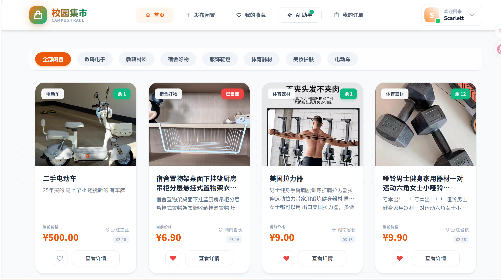
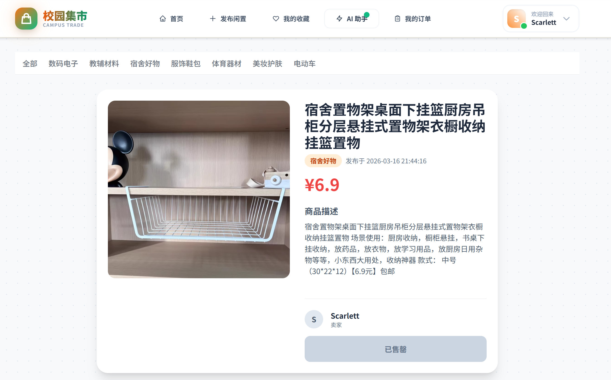
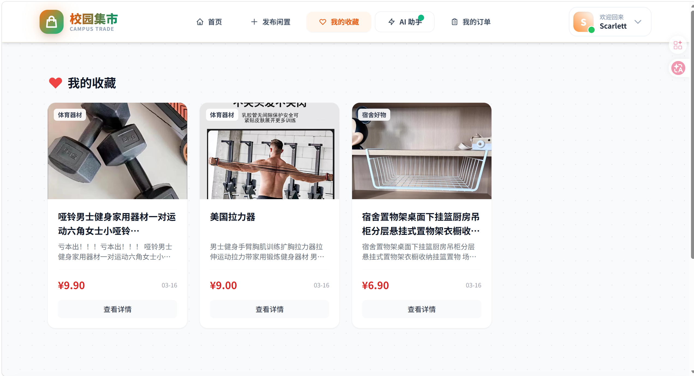
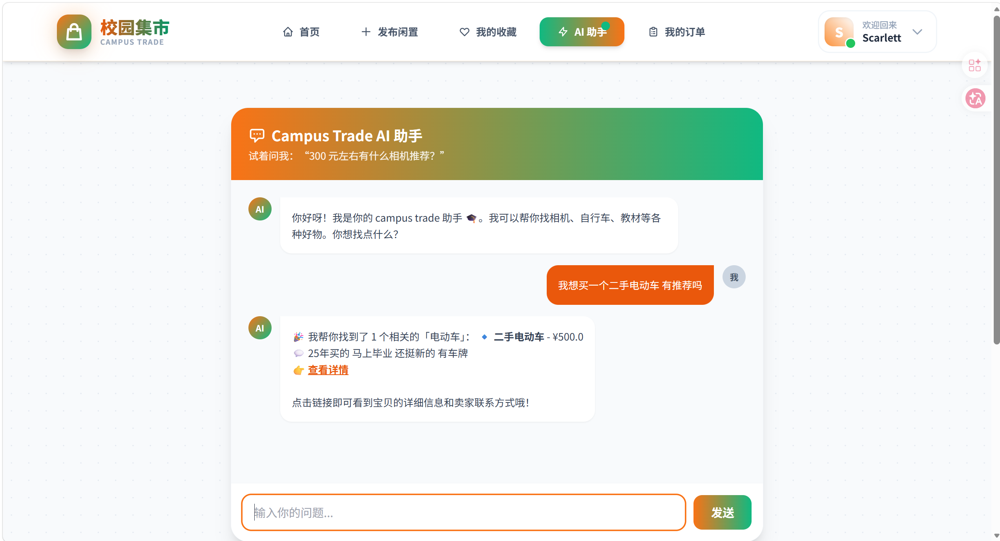
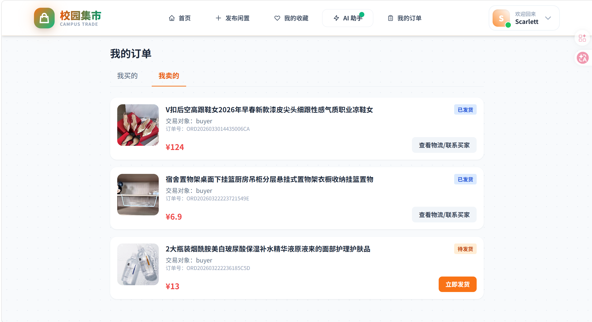
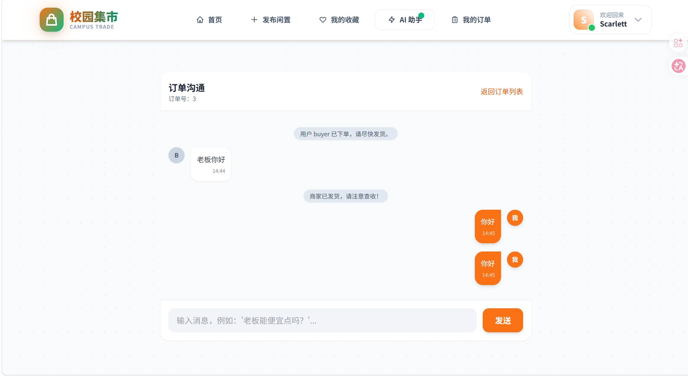
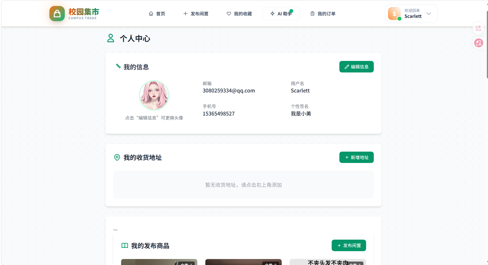

# 1.项目说明  
本项目采用flask框架，设计了用户模块、商品模块、订单模块、收藏模块、商户沟通模块以及AI智能推荐模块，基本实现了一个校园二手交易市场网站。下面是一些页面展示。  
  
  
  
  
  
  
  
# 2. 项目食用指南
首先，请确保您的开发环境已安装 **Python 3.10.19。**  
本项目的核心亮点在于集成了 AI 能力，因此您需要**先在本地搭建 Ollama 服务**，这是实现智能交互的关键基石。  
在启动项目前，**请重点关注 config.py 文件**。这里不仅是**数据库连接的配置中心**，也是用户注册功能的“总控台”——我们需要您在此处填入**正确的邮箱服务参数**，以便系统能够发送验证码，保障账户安全。    
## 这是一个持续生长中的项目。未来，我们将陆续加入自动化测试文件以保障稳定性，同时也非常欢迎您留言提出想要的功能，让我们一起把它建设得更好。  
# 最后，开源之路漫长且充满挑战，如果您喜欢这个项目，请不吝赐教，点亮一颗 Star ️ 吧！这将是开发者最温暖的慰藉。  