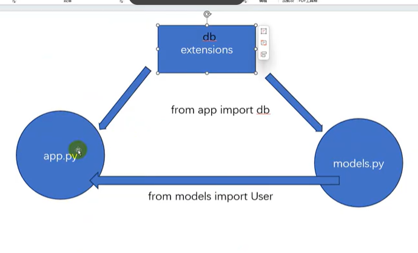
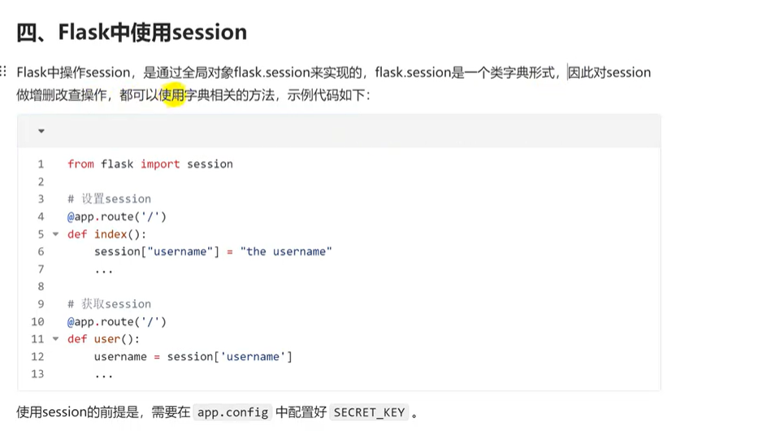
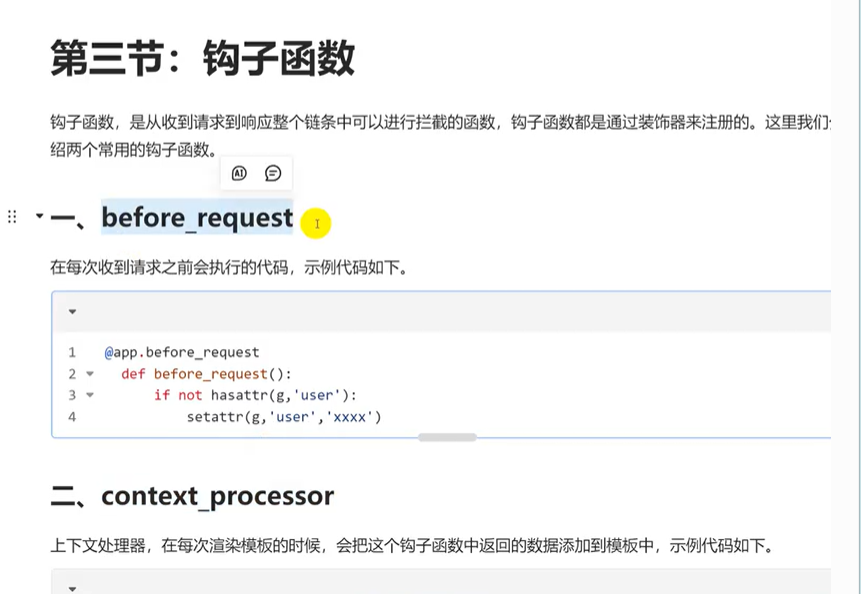
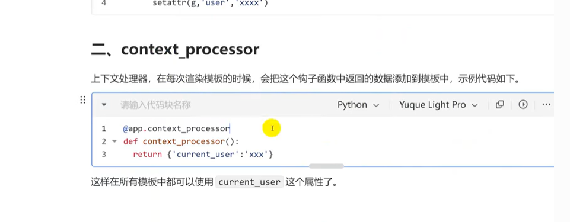

# 1. 关于密码哈希加密  
```python
# 生成哈希密码的关键导入信息
from werkzeug.security import generate_password_hash,check_password_hash
def __init__(self,*args,**kwargs):
        password=kwargs.get('password')
        if password:
            kwargs.pop('password')
        # 其余的该怎么处理怎么处理
        super().__init__(*args,**kwargs)
        self.password=password   
    

@property
def password(self):
    return self.password_hashed
@password.setter
def password(self,password):
    self.password_hashed = generate_password_hash(password)
```
**1.1. *args,**kwargs：**  
*args	接收任意多个位置参数，打包成「元组」	User(1, "张三") → args = (1, "张三")  
**kwargs	接收任意多个关键字参数，打包成「字典」	User(username="张三") → kwargs = {"username": "张三"}  
用户传进来的参数可能包含未被加密过的原始密码，所以如果我发现传进来的参数里面有password，我就提取出明文密码后，**先把password从字典中删除掉，再利用@property和@password.setter，将明文密码转换为哈希密码后，把哈希密码直接赋值给对象的 password_hashed 属性（self.password_hashed）**   
**2.2. 两个装饰器 @property @password.setter**  
`这两个装饰器的核心作用是：把「函数」伪装成「属性」，让你用 “赋值 / 取值” 的简单语法，执行复杂的加密逻辑。@property装饰器定义的函数用于提取密文，password.settle实现了加密。只要给明文，就会自动返回初始化函数里面加密后的密文。`
理解的逻辑是：self.password=password，对password赋值触发了加密函数，所以返回了密文
`kwargs.get('password') 只是从参数里 “拿出明文密码”，self.password = password 才是 “把明文密码交给加密函数”，加密后的结果会自动存到 self.password_hashed 里；想读加密后的密码时，print(self.password) 会触发 @property，直接拿出 self.password_hashed 里的密文。`

2. 关于项目结构优化--models.py
直接import model，app.py要用model.py里面的类，而models.py的第一行又要app.py的db，造成了死锁，所以引入extention.py，即exts.py  
  
extensions 里面创建好db，models导入extensions创建好的db，从而完成表格设计类，app.py里面就可以直接使用

3. 数据库连接部分 想要让数据库根据代码自动创建表格
    1. flask db init
   2. flask db migrate `创建迁移脚本，这一步完成就可以创建表格`
   3. flask db upgrade

4. 获取验证码
### 前端：.js  
1. 特别注意：  
`setInterval 是 JavaScript 中用于重复执行某个函数的定时器，语法是：
javascript
运行
setInterval(要执行的函数, 执行间隔时间(毫秒), 可选参数);
第二个参数的作用：指定 “每次执行函数的间隔时间”，单位是毫秒（1 秒 = 1000 毫秒）；
关键规则：
如果省略 / 不指定第二个参数 → 浏览器会默认按 0 毫秒处理（实际执行间隔极短，约几毫秒）；
如果指定 1000 → 每 1000 毫秒（1 秒）执行一次函数。`
自己敲的时候漏了第二个参数，导致倒计时瞬间完成，没有出现效果 
2. 这段代码是前端通过 jQuery 发送一个 GET 类型的 AJAX 请求，目标是调用你之前写的后端 /email/code 接口，把用户输入的 email 作为参数传递给后端，并在请求成功后，把后端返回的结果打印到浏览器控制台。
前置知识
这是 jQuery 封装的 AJAX 方法，使用前需要确保页面已引入 jQuery 库； AJAX 的核心作用是：前端在不刷新页面的情况下，异步向后端发送请求并获取数据（比如你点击 “发送验证码” 按钮，页面不刷新，但能把邮箱传给后端）； 这段代码和你之前的后端 /email/code 接口是 “前后端配合” 的关系：前端传 email 参数，后端校验后返回结果。
逐部分拆解代码
先贴完整代码，再逐行解释：

`$.get({
    url:"/email/code",
    data:{email:email},
    success:function(result){
        console.log(result);
    }
})`
1. $.get() 核心方法
$：jQuery 的核心标识（和你之前问的 $("#send-code") 里的 $ 是同一个）；
.get()：jQuery 封装的简化版 GET 请求方法，专门用来发送 GET 类型的 AJAX 请求；
写法说明：$.get() 有两种常用写法，你这里是 “对象参数式”（更清晰），另一种是简化版 $.get(url, data, success)，两者功能一致；
作用：替代原生 JS 复杂的 XMLHttpRequest，快速发送 GET 请求。
2. 配置对象里的核心参数
$.get() 括号里是一个配置对象，包含请求的关键信息，逐个解释：
(1) url:"/email/code"
url：指定请求的后端接口地址；
这里的 /email/code 对应你之前后端定义的 @app.get("/email/code") 接口路径；
完整请求地址：浏览器会自动拼接当前域名 / 端口，比如当前页面是 http://localhost:8000，则实际请求地址是 http://localhost:8000/email/code。
(2) data:{email:email}
data：指定要传递给后端的请求参数（GET 请求会自动拼到 URL 后面）；
格式：键值对形式的对象（key: value）；
具体含义：
键 email：参数名（对应后端 request.args.get("email") 里的 "email"）；
值 email：前端变量（比如用户输入的邮箱地址，如 test@163.com）；
拼接后的 URL 示例：/email/code?email=test@163.com（和你之前测试后端接口的 URL 格式一致）。
(3) success:function(result){ console.log(result); }
success：请求成功后执行的回调函数（只有后端正常返回结果，才会触发）；
result：回调函数的参数，代表后端返回的响应数据（就是后端接口 return 的 JSON 数据）；
console.log(result)：把后端返回的结果打印到浏览器的控制台（F12 可查看）；
举例：
如果前端传的 email 为空，后端返回 {"request":false,"message":"email is empty"}，则 result 就是这个对象，控制台会打印这个结果；
如果 email 不为空，控制台会打印 {"request":true,"message":null}。
完整执行流程（结合前后端）
前端执行这段 $.get() 代码 → 向 http://localhost:8000/email/code 发送 GET 请求，参数是 email=用户输入的邮箱；
后端 /email/code 接口接收请求 → 取出 email 参数 → 校验是否为空；
后端返回 JSON 结果给前端；
前端 success 回调函数触发 → 把后端返回的 result 打印到控制台。
补充：$.get() 的完整参数（拓展）
为了让你更全面理解，$.get() 还支持更多参数，完整格式如下：
javascript
运行
$.get({
    url: "请求地址",
    data: "请求参数",
    dataType: "预期返回数据类型（如json）",
    success: function(result) { // 请求成功回调 },
    error: function(xhr) { // 请求失败回调（比如接口404、500）
        console.log("请求失败：", xhr);
    }
});
测试示例
假设前端变量 email = "test@163.com"，执行这段代码后：
实际请求 URL：/email/code?email=test@163.com；
后端返回：{"request":true,"message":null}；
浏览器控制台打印：{request: true, message: null}。
总结
$.get()：jQuery 封装的 GET 类型 AJAX 请求方法，用于异步向后端发请求；
url:"/email/code"：指定要调用的后端接口路径；
data:{email:email}：把前端的 email 变量作为参数传给后端（拼在 URL 后）；
success:function(result)：请求成功后执行的函数，result 是后端返回的结果，这里用来打印结果到控制台。
这段代码是前端调用后端 “邮箱验证码接口” 的核心逻辑，后续可以在 success 里加判断（比如根据 result.request 是否为 true，决定是否显示倒计时、提示成功 / 失败）。
### 后端：  
```python
from flask import request,jsonify
@app.get("/email/code")
def get_email_code():
    # 这段代码定义了一个 GET 类型的 API 接口，路径是 /email/code，核心功能是：接收前端传递的 email 参数，检查该参数是否为空；如果为空则返回失败提示，否则返回成功提示（这通常是 “发送邮箱验证码” 接口的第一步校验逻辑）
    # request.args 是 FastAPI 中获取 URL 问号后查询参数 的方式（比如 http://localhost:8000/email/code?email=test@163.com 中的 email=test@163.com）。
    email=request.args.get("email")
    if not email:
        return jsonify({"request":False,"message":"email is empty"})
    else:
        return jsonify({"request":True,"message":None})

```
发送邮件，下载了一个插件：flask-mail  **pip install Flask-Mail**

5. session cookie
  
6. 钩子函数  
  
  
钩子函数是 Flask 给你的 “定制入口”，让你能在请求的关键节点插自己的逻辑；
你只需要写 “要做什么”（比如打印日志、加响应头），Flask 帮你管 “什么时候做”；
常用钩子：before_request（请求前）、after_request（响应前）、teardown_request（请求结束）。
比如你做蔬菜项目时，可以用 @app.before_request 检查用户是否登录（未登录就跳转到登录页），不用在每个路由里都写一遍登录检查 —— 这就是钩子函数最实用的场景：统一处理全局逻辑，减少重复代码。  
```python
@app.before_request
def before_request():
    # 在每次请求到达视图函数前，自动从 session 中获取用户登录状态，并把用户信息绑定到 g 对象上，让所有视图函数都能直接用当前登录用户的信息。
    # 做网站时，每个页面都需要知道 “当前是谁在访问”（比如登录后显示用户名，未登录显示 “登录 / 注册”）。如果在每个路由里都写 “从 session 取 user_id → 查用户 → 赋值”，会重复大量代码；用 @app.before_request 这个钩子，只写一次，所有路由都能直接用 g.user 获取当前用户
    user_id=session.get('user_id')
    if user_id:
        user=db.session.get(User,user_id)
        # g 是线程级全局变量
        g.user=user
    else:
        g.user=None
# 你之前写的 @app.before_request 是 “请求前查用户，存在 g 里”，现在的 @app.context_processor 是 “渲染模板时，把 g.user 自动传给所有模板”，两者配合是 Flask 处理登录用户的 “黄金组合”
# 两个装饰器，一个装饰器存用户信息；一个装饰器负责把用户信息返回给所有页面
@app.context_processor
def context_processor():
    # 给所有模板注入一个名为 user 的全局变量，值是 g.user（当前登录用户）；
    # 如果用户未登录，user 就是 None
    return{
        'user':g.user
    }


```
7. 未登录功能限制  
`第一步：拆解代码的执行顺序（关键！） 
Python 中装饰器的执行规则是：离函数最近的装饰器先执行（从下到上）。你的代码：
@app.route('/pub')  # 装饰器2：注册路由
@login_required     # 装饰器1：登录验证（离pub更近，先执行）
def pub():
    pass
等价于手动执行以下 3 步（去掉语法糖，还原本质）：
步骤 1：定义原始的 pub 函数
python
运行
 第一步：创建一个空函数 pub，只有 pass（啥也不做）
def pub():
    pass
步骤 2：用 login_required 装饰 pub（新增登录验证）
python
运行
 第二步：把 pub 传给 login_required，得到「带登录验证的新 pub 函数」
 新 pub 函数 = inner 函数（即登录判断逻辑 + 原 pub 函数）
pub = login_required(pub)
此时的 pub 已经不是原来的空函数了，而是变成了 login_required 里的 inner 函数：
python
运行
 此时 pub 等价于这个 inner 函数
def inner(*args, **kwargs):
    if g.user:  # 登录判断
        return 原pub函数(*args, **kwargs)  # 原pub是pass
    else:
        return redirect('/login')
步骤 3：用 @app.route('/pub') 注册路由（绑定 URL 和新 pub 函数）
python
运行
 第三步：把「带登录验证的 pub 函数」注册为 /pub 路由
 意思是：用户访问 /pub 时，执行这个带登录验证的 pub 函数
@app.route('/pub')(pub)
第二步：访问 /pub 时的完整执行流程（终于懂了！）
当你在浏览器输入 http://127.0.0.1:5000/pub 时：
Flask 找到 /pub 对应的函数 → 就是那个「带登录验证的 pub 函数（inner）」；
执行 inner 函数（登录判断逻辑）：
如果 g.user 有值（已登录）→ 执行原 pub 函数（pass，啥也不做）；
如果 g.user 是 None（未登录）→ 跳转到 /login；
返回执行结果（要么 pass，要么跳转）。`